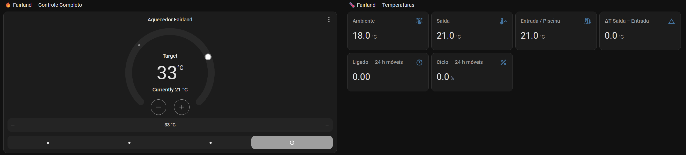

# Tholz Fairland for Home Assistant

An unofficial Home Assistant custom integration for cloud-connected **Tholz Fairland / TurboSilence pool heat pumps**.

It presents the heat pump as a Home Assistant water heater and adds operating telemetry, fan-mode control, rolling activity metrics, and a read-only view of the configured schedule.

> This project is not affiliated with or endorsed by Tholz or Fairland. It depends on the vendor cloud and may stop working if that service or its interfaces change.

## Features

- Water-heater control:
  - Off
  - Automatic
  - Heat
  - Cool
  - target temperature from 12–40 °C
- Fan mode: Silent or Intelligent
- Read-only telemetry:
  - ambient, water inlet, and water outlet temperatures
  - running state, connection state, and device error code
  - heating active time and duty cycle over the previous 24 hours
  - five schedule slots plus schedule diagnostics
- Credential rotation handling and Home Assistant reauthentication
- Safe command handling:
  - only operation mode, target temperature, and fan mode are writable
  - every command starts from a fresh reported-state baseline
  - success requires the reported state to match and the pending delta to clear
  - waits are bounded; failed convergence triggers an attempt to restore the baseline

The schedule is deliberately read-only.

## Requirements

- Home Assistant 2025.2.4 or newer
- A supported heat pump already linked to the Tholz cloud service
- Cloud session values for the same account and device:
  - cloud user identifier
  - app client secret
  - refresh token
  - device identifier
- Internet access from Home Assistant to the vendor's cloud and AWS services

This integration supports only the cloud-connected Fairland/TurboSilence product family. Other Tholz controllers, lighting, auxiliary outputs, and switches are outside its scope. Installations of other Tholz integrations remain independent.

## Installation

1. Download the repository.
2. Copy `custom_components/tholz_fairland` into your Home Assistant `custom_components` directory.
3. Restart Home Assistant.

## Configuration

1. Open **Settings → Devices & services → Add integration**.
2. Search for **Tholz Fairland**.
3. Enter a display name and the cloud session values for your account and device.
4. Optionally provide the account e-mail and choose a **recovery mode**:
   - **Interactive** (default): stores no password. When the cloud rejects the
     stored session, Home Assistant asks you to sign in again.
   - **Automatic**: also stores the account password so the integration can sign
     in again on its own. This trades some secret exposure (see Privacy and
     security) for unattended recovery.
5. Choose a polling interval from 10–300 seconds. The default is 30 seconds.

Setup performs authentication and read-only state requests. It does not send a heat-pump command.

The device identifier is fixed after setup. The polling frequency can be changed
under the integration's **Configure** action, and the recovery mode under
**Reconfigure**. If the cloud rejects every stored token, Home Assistant opens a
reauthentication flow that asks for the account e-mail and password (completing
any multi-factor or new-password challenge the account requires); in automatic
mode the same sign-in then runs unattended. Recovery reuses the existing entry,
so devices, entities, dashboards, automations, and history are preserved.

## Entities

| Platform | Entity | Access |
| --- | --- | --- |
| Water heater | Pool heat pump | Read/write |
| Select | Fan mode | Read/write |
| Sensor | Ambient temperature | Read-only |
| Sensor | Inlet temperature | Read-only |
| Sensor | Outlet temperature | Read-only |
| Binary sensor | Heat pump running | Read-only |
| Binary sensor | Online | Read-only |
| Binary sensor | Problem | Read-only |
| Sensor | Error code | Read-only |
| Sensor | Heating active time, previous 24 hours | Read-only |
| Sensor | Heating duty cycle, previous 24 hours | Read-only |
| Sensors | Five schedule slots and diagnostics | Read-only |

Availability depends on fields reported by the device and cloud service.

## Dashboard preview

The screenshot shows one possible Home Assistant dashboard. Click the image to open it at full resolution.

## Optional dashboard

The integration works with Home Assistant's standard device page and does not install or modify dashboards. A native-card dashboard example is available in [`examples/dashboard-native.yaml`](examples/dashboard-native.yaml), with setup notes in [`examples/README.md`](examples/README.md).

The example is optional, uses no custom cards, and can be adapted to the entity IDs created by your installation.

## Privacy and security

Home Assistant stores the cloud user identifier, app client secret, refresh token, recovery seed token, device identifier, account e-mail, and integration options in its config-entry storage. In **automatic** recovery mode it also stores the account **password**; in **interactive** mode it does not.

The password selector masks the value in the interface but does not encrypt it: in automatic mode the password is present in `.storage` and in any backup that includes this entry. Enable automatic mode only if you accept that exposure. Switch back to interactive mode at any time under **Reconfigure**, which removes the stored password; a rollback to an earlier build leaves the stored password in place until you reconfigure or restore a clean backup.

This integration never writes credentials, tokens, SRP values, `SECRET_HASH`, authorization headers, or Cognito challenge sessions to logs, diagnostics, or error messages, and it does not enable debug logging for any third-party library. Challenge sessions exist only in flow memory and are discarded when the flow ends.

One caveat outside the integration's control: the AWS SDK (`botocore`) logs full request and response contents — including tokens, new passwords, `SECRET_HASH`, and challenge sessions — at `DEBUG`. Do not set `DEBUG` logging for `botocore`, `boto3`, `urllib3`, or the root logger in production. Scope any debugging to `custom_components.tholz_fairland`, whose own log lines are sanitized.

At runtime it sends credentials and device data only to the vendor-operated authentication, device, metrics, and messaging services required for the integration. Metrics and schedule data remain read-only. No analytics or telemetry are sent to this project's maintainers.

Protect Home Assistant backups because they can contain config-entry credentials, including the password in automatic mode. Remove the integration and change the account password if the Home Assistant installation or a backup is exposed.

## Limitations

- Cloud access is mandatory; there is no local fallback.
- Vendor outages, account changes, rate limits, or interface changes can make entities unavailable.
- Initial setup requires session values that the vendor app does not currently expose as a Home Assistant-friendly login flow.
- Schedules can be viewed but not edited.
- Only the documented Fairland/TurboSilence mode, setpoint, and fan controls are supported.
- A failed command can leave the device unavailable even after rollback is attempted. Verify the physical equipment if Home Assistant reports an error.

## Support

Before reporting a problem:

1. Update Home Assistant and this integration.
2. Reload the integration.
3. Confirm the device is online in the vendor app.
4. Check **Settings → System → Logs** for `tholz_fairland` messages.
5. Remove credentials and device identifiers from any log excerpt before sharing it.

Use the repository issue tracker for reproducible bugs. Include the integration version, Home Assistant version, affected entity, expected behavior, actual behavior, and sanitized logs. Do not post passwords, tokens, account identifiers, device identifiers, backups, or complete config entries.

## License

MIT. See [LICENSE](LICENSE). The extracted implementation retains the original project's copyright notice.
