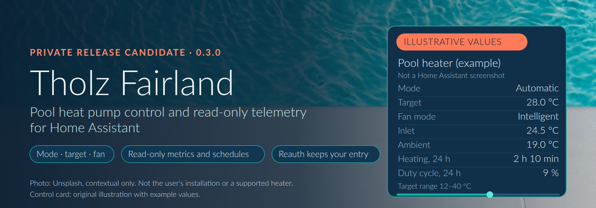
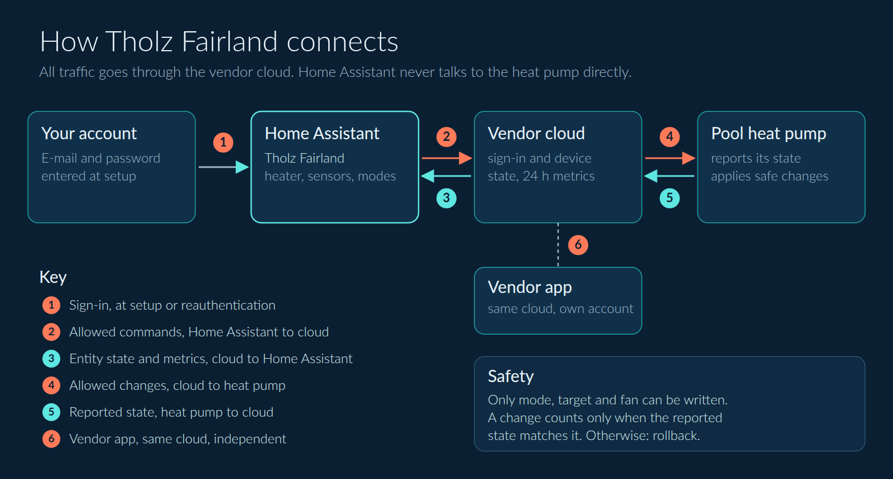
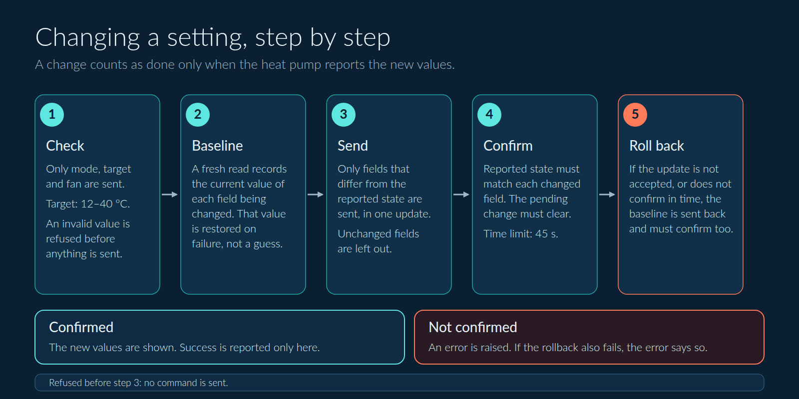
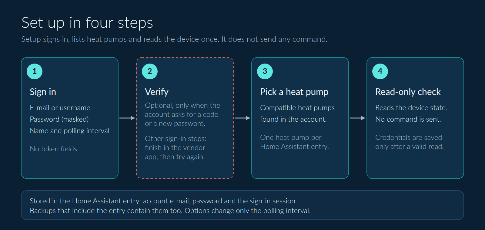
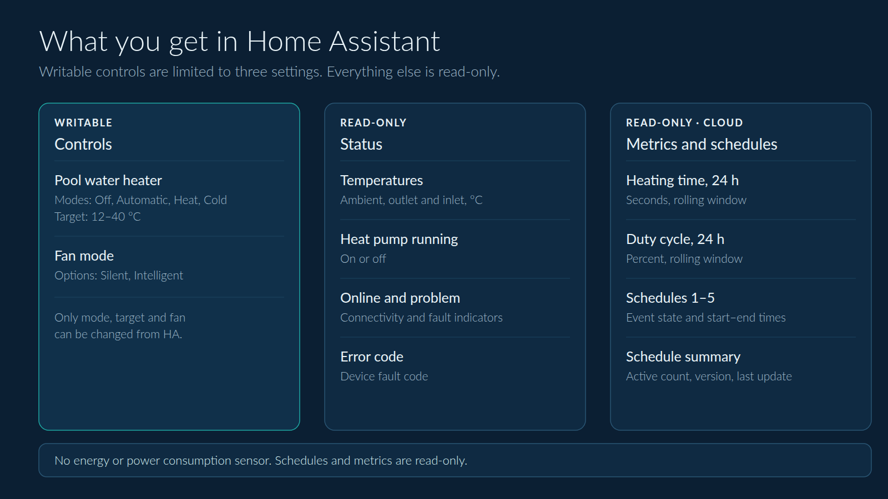
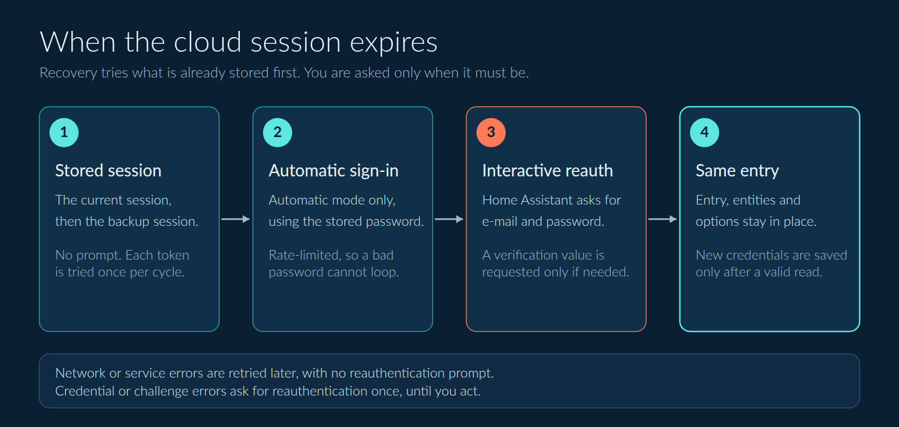

  

# Tholz Fairland for Home Assistant

**Your pool heat pump, connected to your Home Assistant routines.**

An unofficial custom integration for cloud-connected **Tholz Fairland / TurboSilence pool heat pumps**. Change the operating mode, adjust the target water temperature, choose the fan mode, and understand what the equipment is doing—from one device page or your own dashboard.

> Derived from [tholz-hass-integration](https://github.com/felippepuhle/tholz-hass-integration) by **Felippe Rodrigo Puhle**. See [Origin and acknowledgements](#origin-and-acknowledgements).

[Leia em português](README.pt-BR.md) · [User guide](docs/en/README.md) · [Installation](docs/en/installation.md) · [Configuration](docs/en/configuration.md) · [Troubleshooting](docs/en/troubleshooting.md)

> Not affiliated with or endorsed by Tholz, Fairland, or Home Assistant. An internet connection and the manufacturer's cloud service are required. This project does not provide a local-control fallback.

## Validation status

Real-account setup, entity loading, state reads, and unloading/reloading the integration have been verified. These results support using the verified setup and monitoring features; they are not a certification of every physical control or temperature measurement.

**Target-temperature commands have not passed physical acceptance.** In the observed trials with the heat pump Off, the requested target change was not confirmed. This does not establish a firmware restriction and does not invalidate the verified setup and monitoring features. Changing the target while Off is **not a prerequisite for using those features**, and no additional temperature trial is required for read-only use. Automated tests and accepted input ranges do not prove that a physical command took effect.

Public availability does not change the integration's command safeguards or certify untested physical controls.

## At a glance

| Control | Observe | Connect |
| --- | --- | --- |
| Off, Automatic, Heat, Cool | Ambient, inlet, and outlet water temperatures | Sign in with the account used in the vendor app |
| Mode-dependent target temperature | Running, online, and problem indicators | Discover compatible heat pumps automatically |
| Silent or Intelligent fan mode | Device error code, 24-hour activity, and schedule slots | Recover the cloud session without recreating your device |

**No manual tokens or device identifiers are required for new account-based setup.** If the account requests verification or a new password, the configuration assistant guides you through it. When multiple supported heat pumps are associated with the account, select the one to add.

## What you can do

### Control the heat pump

- Choose **Off**, **Automatic**, **Heat**, or **Cool** through a standard `water_heater` entity.
- Set the target temperature within **12–40 °C in Automatic**, **18–40 °C in Heat**, or **12–30 °C in Cool** for the supported type-7 heat pump.
- Choose **Silent** or **Intelligent** through a separate `select` entity.
- Use Home Assistant's native cards and service actions to build your own routines.

These controls do not operate the circulation pump, filtration system, lights, or auxiliary outputs. Heat-pump operation still depends on the equipment's own safety conditions and water flow.

In **Off**, temperature-only requests retain the legacy **12–40 °C** range and do not turn the device on. Valid reported limits can only narrow these ranges. The interface and transport enforce the same temperature policy and effective step, without silent rounding; changing only the mode does not send a new target temperature. See [temperature limits and step](docs/en/operation.md#temperature-limits-and-step) before adapting automations.

### Monitor the equipment

- See ambient, water-inlet, and water-outlet temperatures.
- Distinguish the requested operating mode from the **running** indicator. A selected heating mode does not mean the compressor is currently operating.
- Check online status, the problem indicator, and the reported device error code.
- Read heating active time and duty cycle **calculated locally from manufacturer activity records** for a **rolling 24-hour** window. The summary has a 5-minute cache; see [metrics, caching and failures](docs/en/operation.md#24-hour-metrics).
- View **five read-only schedule slots**, including readable repeat days in Portuguese, ordered Monday to Sunday. `repeat_days` lists the selected names; `repeat_mask` preserves the raw mask. Change schedules only in the vendor app; see [schedule details](docs/en/operation.md#schedules-read-only).

Activity metrics are not an energy meter. They do not measure electricity consumption, cost, heating output, or efficiency. Availability depends on what the equipment and cloud report.

## How it works

Home Assistant authenticates your account, finds compatible equipment, and exchanges state and supported commands through the manufacturer's cloud. The vendor app remains an independent interface to the same service; it does not need to stay open for Home Assistant to operate.

The integration combines reported-state messages with a periodic update interval. Configure the interval from **10–300 seconds**; the default is **30 seconds**. Network latency, vendor rate limits, cloud outages, and device connectivity can affect updates. No fixed response-time guarantee is made.

### Commands are checked against reported state

1. Read a fresh state before changing the equipment.
2. Send only the supported field: operating mode, target temperature, or fan mode.
3. Wait for the **equipment-reported state** to match and the pending change to clear.
4. If confirmation fails within the bounded wait, attempt to restore the baseline and surface an error.

An acknowledgement from the cloud alone is not treated as confirmation that the equipment changed. Restoration is an attempt, not a guarantee: verify the vendor app or physical equipment after a failed command. Home Assistant is not a replacement for the heat pump's hardware safety controls.

## Requirements and compatibility

- **Home Assistant 2025.2.4 or newer**; see the [maintenance guide](docs/en/updating.md) for version and update guidance.
- A cloud-connected Fairland/TurboSilence heat pump already configured and visible in the **Tholz account** you will use.
- An **account username or e-mail and password** usable with the vendor's account sign-in. Social sign-in buttons are not an integration sign-in method.
- Internet access from both Home Assistant and the heat pump to the manufacturer's services.
- Permission to install custom integrations in your Home Assistant configuration.

Supported-family discovery does not certify every model, firmware, or account arrangement. Other Tholz controllers and other product families are outside this integration's scope. Existing integrations using another domain remain independent.

## Install and configure

### HACS installation (recommended)

**HACS must already be installed.**

1. In HACS, search for **Tholz Fairland** and open it.
2. Select **Download** and confirm.
3. Restart Home Assistant.
4. Go to **Settings → Devices & services → Add integration → Tholz Fairland**.

### Manual installation

If you do not use HACS, back up Home Assistant, download the [manual integration package](https://github.com/marzliak/ha-tholz-fairland/releases/download/v0.3.0/tholz-fairland-0.3.0-integration.zip), and follow the [installation guide](docs/en/installation.md#3-download-and-check-the-package) for Home Assistant OS or Container.

### Account setup

1. Give the integration a display name.
2. Enter your vendor-app **e-mail/username and password**.
3. Complete a verification or new-password challenge if the account requests it.
4. Choose a heat pump when the account has more than one compatible device.
5. Keep the default update interval or choose a value between 10 and 300 seconds.

Initial setup authenticates, discovers devices, and validates a **read-only state request**. **It does not turn the heat pump on or send a temperature or fan command.** Illustrated setup panels in this documentation are explanatory guides, not screenshots of a new live installation.

## Entities and everyday use

| Home Assistant platform | Purpose | Access |
| --- | --- | --- |
| `water_heater` | Mode, target temperature, current water temperature | Read/write |
| `select` | Silent / Intelligent fan mode | Read/write |
| `sensor` | Ambient, inlet, and outlet temperatures | Read-only |
| `binary_sensor` | Running, online, and problem | Read-only |
| `sensor` | Reported error code | Read-only |
| `sensor` | Heating activity and duty cycle, previous rolling 24 hours | Read-only |
| `sensor` | Five schedule slots and schedule details | Read-only |

Entity IDs depend on names, language, and Home Assistant's registry. Use the entities actually created in **your** installation when adapting examples. The inlet temperature is a useful view of water entering the equipment, not a separate pool-wide measurement.

Read the [operation guide](docs/en/operation.md) for the differences between target/current temperatures, mode/running state, unavailable/offline state, and schedule/activity data.

## Build your dashboard

*Existing example screenshot. Its values illustrate one captured state; they are not current equipment readings or the result of the preparation tests. The screenshot may differ from your Home Assistant version and card layout.*

The integration works on Home Assistant's standard device page. It does **not** install a dashboard or change your views automatically.

- [Native dashboard example](examples/dashboard-native.yaml): adapt it to your entity IDs; no third-party cards are needed.
- [Dashboard guide](docs/en/dashboard.md): card layout, sensor selection, temperature interpretation, and troubleshooting.
- [Automation guide](docs/en/automations.md): optional notification and control examples, with checks and explicit operator choices.

Never import example automations blindly. Confirm entity IDs, choose your own limits, and verify circulation and equipment safety requirements before enabling automatic heat-pump commands.

## Session recovery and updates

The integration renews its stored cloud session. If all stored refresh tokens are rejected, it attempts account sign-in using the saved credentials. When verification or another user action is required, Home Assistant opens a reauthentication flow.

Recovery updates the **existing configuration entry**, rather than creating a new device. This preserves its entity relationships; user-facing IDs and history still follow Home Assistant's registry rules.

- **Configure** changes the update interval.
- **Reconfigure** updates the account credentials for the same account and device.
- **Reauthentication** responds to a session recovery request.
- Add a separate integration entry for another heat pump.

See [configuration](docs/en/configuration.md) and [updating](docs/en/updating.md) for detailed walkthroughs.

## Privacy and security

Account credentials and session values are stored in Home Assistant's configuration-entry storage for unattended session recovery. The password field is masked in the interface; **these fields are not individually encrypted at rest**. Protect the configuration directory, host access, and backups.

The integration communicates with the vendor-operated account, device, metrics, and messaging services needed to operate. It does not send project analytics to the maintainers. It is designed not to include credentials in its own log messages.

Do **not** enable broad `DEBUG` logging for `botocore`, `boto3`, `urllib3`, or the root logger: third-party request logging can include account/session information. If debugging is necessary, scope it to `custom_components.tholz_fairland` and review excerpts before sharing them.

[Read the privacy and credential-handling guide](docs/en/privacy.md). If a host or backup is exposed, change the cloud password and review/revoke sessions using the account tools available from the vendor.

## Limitations

- Cloud access is mandatory; there is no local fallback or offline control.
- Vendor outages, rate limits, account changes, and service-interface changes can interrupt the integration.
- Not every Tholz device is supported; the scope is the cloud-connected Fairland/TurboSilence family.
- The five equipment schedule slots are **read-only**.
- No energy, tariff, COP, or electricity-cost measurement is provided.
- Fan control is limited to **Silent** and **Intelligent**; Turbo is not exposed.
- A failed command can leave state uncertain even after a restoration attempt.
- The integration cannot bypass equipment protections, guarantee heating times, or control your filtration/circulation system.

## Help and documentation

| Start here | Reference |
| --- | --- |
| [Installation](docs/en/installation.md) | [Troubleshooting](docs/en/troubleshooting.md) |
| [Configuration](docs/en/configuration.md) | [Frequently asked questions](docs/en/FAQ.md) |
| [Operation](docs/en/operation.md) | [Privacy and security](docs/en/privacy.md) |
| [Dashboard](docs/en/dashboard.md) | [Updating and removal](docs/en/updating.md) |
| [Automations](docs/en/automations.md) | [Version 0.3.0 notes](docs/releases/0.3.0.md) |

Before reporting a problem, verify the device is visible and online in the vendor app, reload the integration, and consult **Settings → System → Logs**. Include the integration version, Home Assistant version, affected entity, expected behavior, and observed behavior. **Do not share passwords, tokens, account or device identifiers, complete configuration entries, or backups.**

## Origin and acknowledgements

This project is derived from [tholz-hass-integration](https://github.com/felippepuhle/tholz-hass-integration), created by **Felippe Rodrigo Puhle** and released under the MIT License. Parts of the Home Assistant integration structure, utilities, and entities have been reused and adapted.

This repository is maintained separately for cloud communication with Fairland/TurboSilence equipment, including account authentication, device discovery, and session recovery. Separate maintenance does not imply involvement or endorsement by the original author.

The original copyright notice and license text are preserved in [LICENSE](LICENSE).

## Contributing and licensing

See [CONTRIBUTING.md](CONTRIBUTING.md) for development and testing. [CHANGELOG.md](CHANGELOG.md) records user-visible changes.

Code and original project artwork: **MIT**, retaining the copyright notice in [LICENSE](LICENSE). Tholz, Fairland, TurboSilence, and Home Assistant names identify their respective products; their use does not imply endorsement. The contextual pool photograph has its own licence and is not a photograph of a supported heat pump. See [image credits and licences](docs/ASSETS.md).
