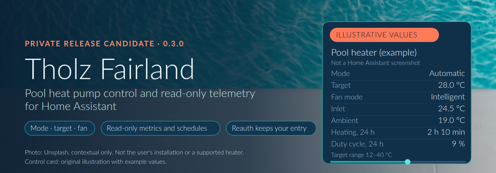
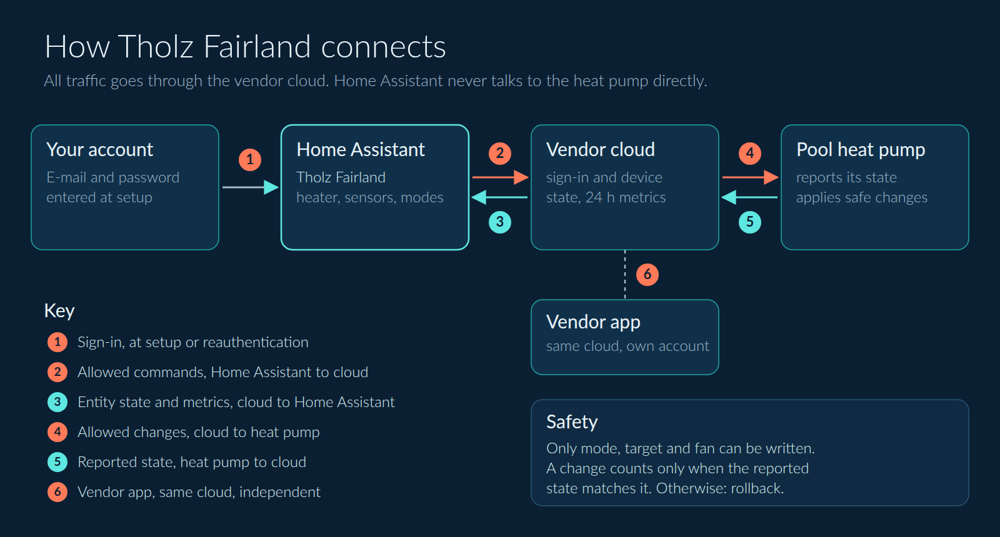
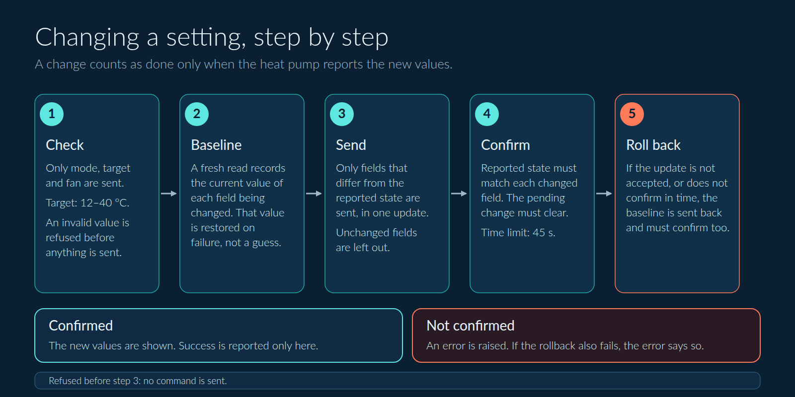
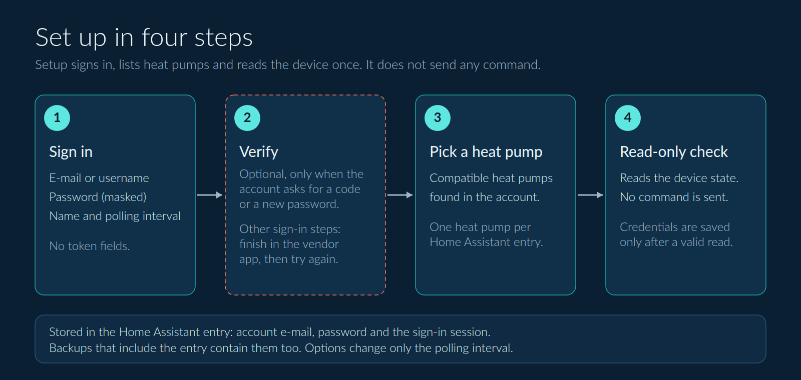
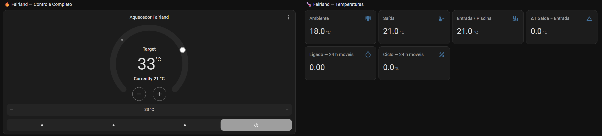
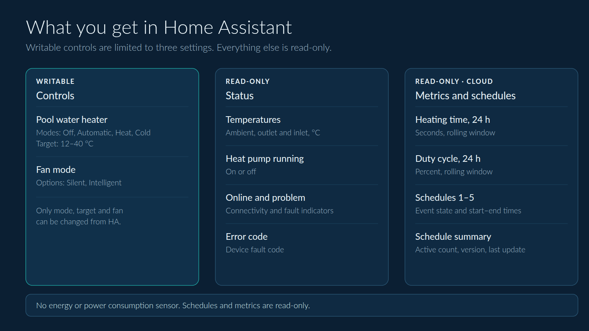
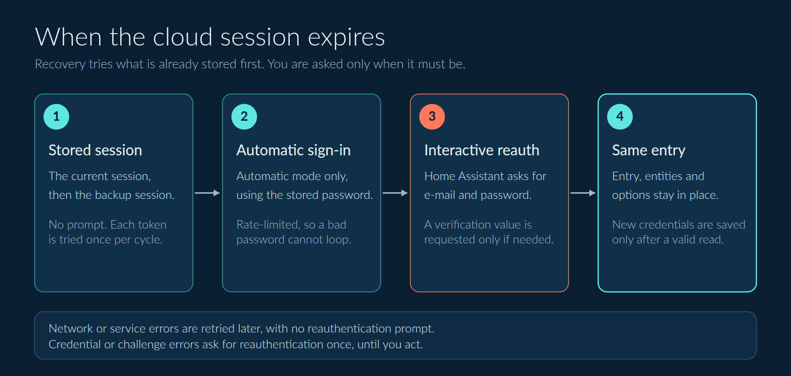

  

# Tholz Fairland para Home Assistant

**Seu trocador de calor integrado aos painéis e às rotinas do Home Assistant.**

[Read in English](README.md) · [Guia completo](docs/README.md) · [Instalação](docs/installation.md) · [Configuração](docs/configuration.md) · [Solução de problemas](docs/troubleshooting.md)

Integração **não oficial** do Home Assistant para bombas de calor **Tholz Fairland / TurboSilence** conectadas à nuvem.

Ela apresenta o equipamento como um aquecedor (water heater) do Home Assistant e adiciona telemetria de operação, seletor de modo do ventilador, métricas de 24 horas e uma visão somente leitura das agendas.

> Derivado da integração [tholz-hass-integration](https://github.com/felippepuhle/tholz-hass-integration), de **Felippe Rodrigo Puhle**. Consulte [Origem e créditos](#origem-e-créditos).

> Este projeto não é afiliado nem endossado pela Tholz ou pela Fairland. Ele depende da nuvem do fabricante e pode deixar de funcionar se esse serviço ou suas interfaces mudarem.

**0.3.0 é a primeira versão pública (2026-11-16).** Veja a [release](https://github.com/marzliak/ha-tholz-fairland/releases/tag/v0.3.0).

## Estado de validação

Foram verificados o cadastro com conta real, o carregamento das entidades, as leituras de estado e o descarregamento/recarregamento da integração. Esses resultados comprovam os fluxos verificados de cadastro e acompanhamento; não certificam todos os comandos físicos nem a exatidão das medições de temperatura.

**O comando de temperatura-alvo não passou no aceite físico.** Nos ensaios observados com o aquecedor desligado, a mudança solicitada não foi confirmada. Isso não prova uma restrição do firmware e não invalida o cadastro e o acompanhamento já verificados. Mudar a temperatura em Desligado **não é requisito para usar essas funções**, e nenhum novo ensaio de temperatura é necessário para o uso somente leitura. Testes automatizados e faixas de entrada aceitas não comprovam que um comando físico foi aplicado.

A disponibilidade pública não altera as proteções dos comandos nem certifica controles físicos não validados.

## Recursos

- **Controle do aquecedor:** Desligado, Automático, Aquecer e Resfriar; temperatura-alvo por modo no tipo 7: **Automático 12–40 °C**, **Aquecer 18–40 °C** e **Resfriar 12–30 °C**.
- **Ventilador:** Silent ou Intelligent.
- **Telemetria somente leitura:** temperaturas de ambiente, entrada e saída; em funcionamento; online; problema; código de erro; tempo ativo e ciclo de aquecimento calculados localmente a partir dos registros do fabricante na janela móvel de 24 horas; cinco agendas e diagnósticos.
- **Cadastro pela conta:** e-mail ou usuário e senha, descoberta de equipamentos, verificação quando a conta exigir e reautenticação no Home Assistant.
- **Comandos seguros:** só três campos são graváveis. Cada comando parte de uma leitura de base e só é considerado concluído quando o estado reportado coincide e não há mudança pendente. Se não convergir, a integração tenta restaurar a base.

Em **Desligado**, definir apenas a temperatura preserva a faixa legada de **12–40 °C** e não liga o equipamento. Limites válidos reportados só podem restringir as faixas. Interface e transporte aplicam a mesma política e o passo efetivo, sem arredondamento silencioso; mudar apenas o modo não envia uma nova temperatura-alvo. Confira o [guia de limites e passo](docs/operation.md#limites-e-passo-da-temperatura) antes de adaptar automações.

As agendas continuam **somente leitura**: mostram os dias de repetição em português, de segunda a domingo, com a lista `repeat_days` e a máscara bruta preservada em `repeat_mask`. Altere-as somente no aplicativo do fabricante. Veja [agendas](docs/operation.md#agendas-somente-leitura) e [métricas, cache e falhas](docs/operation.md#métricas-das-últimas-24-horas); o resumo de atividade tem cache de 5 minutos e não mede energia, custo ou eficiência.

O indicador **Em funcionamento** é uma leitura do equipamento, não um interruptor. O modo selecionado não garante que o compressor esteja funcionando naquele instante; circulação e proteções continuam sob responsabilidade do equipamento e da instalação.

## Como funciona

O Home Assistant autentica sua conta, encontra os equipamentos compatíveis e troca comandos e leituras com a nuvem do fabricante. O aplicativo continua funcionando como outra interface da mesma conta; não precisa ficar aberto para a integração operar.

As leituras combinam mensagens de estado com atualização periódica. O intervalo é configurável entre **10 e 300 segundos**, com padrão de **30 segundos**. Latência de internet, disponibilidade da nuvem e conexão do equipamento influenciam a atualização; não há promessa de resposta instantânea.

### Um comando não termina só com a confirmação da nuvem

1. A integração faz uma leitura recente do equipamento.
2. Envia apenas modo, temperatura-alvo ou ventilador.
3. Aguarda o estado reportado coincidir e a mudança pendente desaparecer.
4. Em caso de falha, tenta restaurar a base e informa o erro.

A restauração é uma tentativa, não uma garantia. Confira o aplicativo ou o equipamento após uma falha de comando. A integração não substitui proteções físicas e não controla bomba de circulação, filtro, iluminação ou saídas auxiliares.

## Requisitos

- Home Assistant **2025.2.4 ou mais recente**. Testes automatizados passaram em **2025.2.4**, **2026.10.1** e **2026.11.1**, com serviços de nuvem simulados; versões intermediárias e todas as combinações de modelos não são certificadas.
- Uma bomba de calor Fairland / TurboSilence já vinculada à conta do fabricante.
- E-mail ou usuário e senha dessa conta.
- Acesso à internet do Home Assistant para a nuvem do fabricante e serviços AWS.

## Instalação

### Pelo HACS (recomendado)

**O HACS já deve estar instalado.**

1. No HACS, procure por **Tholz Fairland** e abra a integração.
2. Selecione **Download** e confirme.
3. Reinicie o Home Assistant.
4. Vá em **Configurações → Dispositivos e serviços → Adicionar integração → Tholz Fairland**.

### Pelo pacote manual

Use esta opção se você não usa HACS. Faça um backup antes de instalar.

1. Baixe e extraia o [pacote manual 0.3.0](https://github.com/marzliak/ha-tholz-fairland/releases/download/v0.3.0/tholz-fairland-0.3.0-integration.zip).
2. Copie a pasta `tholz_fairland` de `custom_components/` do pacote para `custom_components/` do Home Assistant.
3. Reinicie o Home Assistant.
4. Vá em **Configurações → Dispositivos e serviços → Adicionar integração → Tholz Fairland**.

O guia completo está em [docs/installation.md](docs/installation.md).

## Configuração

**Você não precisa copiar tokens, segredos de cliente nem identificadores técnicos.** O cadastro utiliza a conta do aplicativo. Botões de login social, como Google ou Apple, não são um método de entrada desta integração: é necessária uma credencial de conta utilizável com usuário e senha.

1. Abra **Configurações → Dispositivos e serviços → Adicionar integração**.
2. Pesquise por **Tholz Fairland**.
3. Informe o nome, o e-mail ou usuário e a senha da conta.
4. Conclua a verificação, se a conta pedir.
5. Escolha o equipamento, se houver mais de um.
6. Defina o intervalo de atualização (10 a 300 s; padrão 30 s).

A configuração lê o estado do equipamento antes de salvar. Não envia comando.

Guia completo: [docs/configuration.md](docs/configuration.md).

## Painel e automações

A integração não cria painéis. O exemplo nativo em [examples/dashboard-native.yaml](examples/dashboard-native.yaml) usa somente cartões padrão. Automações de exemplo estão em [examples/automations.yaml](examples/automations.yaml) e **não são ativadas automaticamente**.

*Captura existente de um painel de exemplo. Os valores representam um estado capturado, não leituras atuais nem uma nova instalação feita durante os testes. O desenho pode variar conforme a versão do Home Assistant.*

### O que aparece no Home Assistant

| Entidade | Uso | Acesso |
| --- | --- | --- |
| Aquecedor (`water_heater`) | Modo, temperatura-alvo e temperatura atual da entrada | Leitura e comando |
| Seletor (`select`) | Silent / Intelligent | Leitura e comando |
| Temperaturas (`sensor`) | Ambiente, entrada e saída | Somente leitura |
| Indicadores (`binary_sensor`) | Em funcionamento, online e problema | Somente leitura |
| Código de erro (`sensor`) | Valor reportado pelo equipamento | Somente leitura |
| Atividade 24 h (`sensor`) | Tempo ativo e percentual de atividade da janela móvel | Somente leitura |
| Agendas (`sensor`) | Cinco faixas, quantidade ativa, versão e atualização | Somente leitura |

Os IDs dependem do nome e do registro do Home Assistant. A temperatura de entrada não é uma sonda separada da piscina, e tempo ativo não equivale a consumo elétrico, custo ou eficiência.

## Recuperação da sessão

A integração renova a sessão armazenada. Se os tokens forem rejeitados, tenta entrar novamente com a credencial salva. Quando a conta precisa de código ou outra ação, solicita reautenticação pelo Home Assistant.

A recuperação atualiza a entrada existente, preservando sua relação com dispositivo e entidades. **Configurar** altera o intervalo; **Reconfigurar** atualiza credenciais da mesma conta; outra bomba de calor recebe uma entrada separada. O [guia de configuração](docs/configuration.md) mostra cada caminho.

## Privacidade e segurança

A senha da conta, os tokens de sessão e os identificadores de conta e equipamento ficam **na entrada de configuração** do Home Assistant, para permitir a recuperação automática. Esse armazenamento não é criptografado individualmente. **Backups que incluam a integração contêm essas credenciais.** Proteja o Home Assistant, o acesso ao diretório de configuração e os backups.

A integração não registra senhas nem tokens nos registros. Não ative `DEBUG` para `botocore`, `boto3` ou `urllib3`, porque a biblioteca AWS pode registrar conteúdo de requisições nesse nível.

O guia completo está em [docs/privacy.md](docs/privacy.md).

## Limitações

- Somente nuvem. Sem acesso à nuvem não há controle nem leitura.
- As agendas são somente leitura.
- Somente modo, temperatura-alvo e ventilador são graváveis.
- Métricas de 24 horas são calculadas pela integração a partir dos registros de atividade do fabricante; não medem energia, custo ou eficiência.
- Mudanças do fabricante podem deixar entidades indisponíveis.
- Um comando com falha pode deixar o equipamento indisponível mesmo após a restauração. Verifique o equipamento fisicamente.

## Documentação

- [Índice da documentação (PT-BR)](docs/README.md) · [Documentation index (EN)](docs/en/README.md)
- [Instalação](docs/installation.md) · [Configuração](docs/configuration.md) · [Operação](docs/operation.md)
- [Painel](docs/dashboard.md) · [Automações](docs/automations.md) · [Solução de problemas](docs/troubleshooting.md)
- [Privacidade](docs/privacy.md) · [Atualização](docs/updating.md) · [Perguntas frequentes](docs/FAQ.md)
- [Notas da versão 0.3.0](docs/releases/0.3.0.md)

## Suporte

Antes de relatar um problema:

1. Atualize o Home Assistant e a integração.
2. Recarregue a entrada.
3. Confirme no aplicativo do fabricante que o equipamento está online.
4. Confira os registros de `tholz_fairland` em **Configurações → Sistema → Registros**.
5. Remova credenciais e identificadores de qualquer trecho de registro.

Use o rastreador de issues para erros reproduzíveis. Não publique senhas, tokens, identificadores ou backups. Vulnerabilidades seguem [SECURITY.md](SECURITY.md).

## Origem e créditos

Este projeto é derivado de [tholz-hass-integration](https://github.com/felippepuhle/tholz-hass-integration), criado por **Felippe Rodrigo Puhle** e disponibilizado sob a licença MIT. Partes da estrutura de integração com o Home Assistant, dos utilitários e das entidades foram reutilizadas e adaptadas.

Este repositório mantém um desenvolvimento separado, voltado à comunicação cloud dos equipamentos Fairland/TurboSilence, com autenticação pela conta, descoberta de equipamentos e recuperação de sessão. Essa manutenção separada não implica participação ou endosso do autor original.

O aviso de copyright e o texto da licença original estão preservados em [LICENSE](LICENSE).

## Licença

MIT. Veja [LICENSE](LICENSE).
