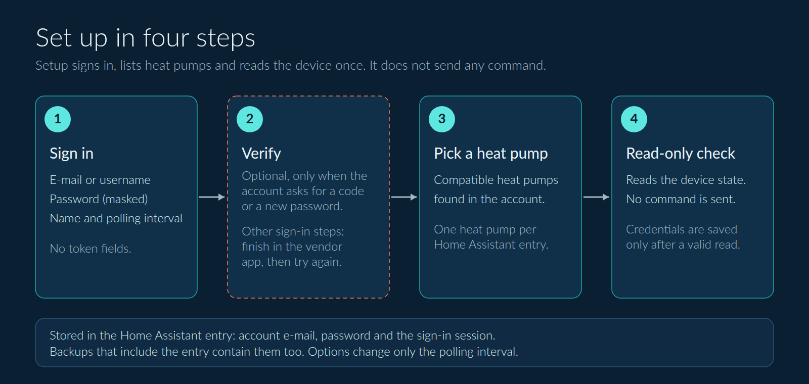
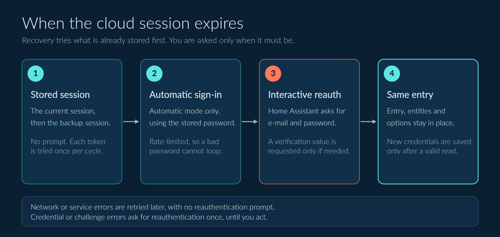

# Configuração

> **Diagrama ilustrativo** do cadastro e da recuperação abaixo. Os textos de tela citados são os da integração nesta versão; os nomes de menus podem variar conforme a versão do Home Assistant.

## Visão geral

O cadastro tem quatro etapas:

1. **Conta:** você informa o nome, o e-mail ou usuário e a senha da conta do fabricante.
2. **Verificação (opcional):** só aparece se a conta exigir um código ou uma nova senha.
3. **Descoberta e escolha:** a integração lista os equipamentos compatíveis da conta. Se houver mais de um, você escolhe um.
4. **Validação:** antes de salvar, a integração faz uma **leitura de estado**. Ela não envia comando algum ao equipamento.

Nada é gravado até que a conta, a descoberta e a leitura tenham dado certo.

## Passo a passo do cadastro

1. Vá em **Configurações → Dispositivos e serviços → Adicionar integração**.
2. Pesquise por **Tholz Fairland**.
3. Preencha o formulário **Conectar uma bomba de calor Tholz Fairland**:

   | Campo | O que informar | Observações |
   |---|---|---|
   | Nome | Nome de exibição, por exemplo `Aquecedor Piscina Fairland` | Define o prefixo dos nomes das entidades. Padrão: `Fairland`. |
   | E-mail ou usuário da conta | O e-mail ou usuário usado no aplicativo do fabricante | Use o mesmo login do aplicativo. |
   | Senha da conta | A senha da conta | Campo mascarado. Veja a seção [Armazenamento da senha](#armazenamento-da-senha). |
   | Intervalo de atualização (segundos) | Valor de 10 a 300 | Padrão: 30. Veja [Intervalo de atualização](#intervalo-de-atualização). |

4. Clique em **Enviar**.
5. Se a conta pedir verificação, siga a seção [Verificação da conta](#verificação-da-conta-opcional).
6. Se houver mais de um equipamento compatível, escolha o desejado em **Selecionar a bomba de calor**.
7. Aguarde a validação. Ao final, a entrada **Tholz Fairland** aparece com o nome que você escolheu.

## Verificação da conta (opcional)

Esta etapa **só aparece se a conta exigir**. Muitas contas não pedem nada além da senha.

| Tela | Quando aparece | O que fazer |
|---|---|---|
| **Concluir o desafio de login** — campo **Código de verificação ou nova senha** | A conta usa código de verificação (SMS, e-mail ou aplicativo autenticador) | Digite o código recebido ou gerado no momento. |
| Mesma tela, campo mascarado | A conta exige que você **defina uma nova senha** | Digite a nova senha. Ela passa a ser a senha guardada para a recuperação automática. |

Cuidados:

- Códigos expiram rapidamente. Se a mensagem disser que o valor não foi aceito, solicite um novo código no aplicativo do fabricante e tente de novo.
- Se a conta exigir uma etapa que a integração não consegue concluir, a tela mostra: **"Finalize o login no app do fabricante e tente novamente."** Conclua a etapa no aplicativo e repita o cadastro.
- Cancelar a tela descarta o fluxo. Nada é salvo.
- Um código ou nova senha nunca deve ser enviado por chat, e-mail ou qualquer outro canal. Digite-o somente no formulário do Home Assistant.

## Descoberta de equipamentos

Após o login, a integração consulta a conta e lista somente os equipamentos **compatíveis** (Fairland / TurboSilence). Outros dispositivos da conta são ignorados.

- **Um equipamento compatível:** é adicionado automaticamente, sem tela de escolha.
- **Vários equipamentos compatíveis:** a tela **Selecionar a bomba de calor** mostra a lista. Cada equipamento precisa de uma entrada própria.
- **Nenhum equipamento compatível:** a mensagem é **"Nenhuma bomba de calor Fairland compatível foi encontrada nesta conta."** Confira no aplicativo do fabricante se o equipamento está vinculado a essa conta.

Após a escolha, a integração lê o estado do equipamento uma vez. Se essa leitura falhar, nada é salvo. A integração **nunca envia comando durante o cadastro**.

## Mensagens de erro do cadastro

| Mensagem exibida | Significado | Ação |
|---|---|---|
| O e-mail ou a senha da conta foi rejeitado | A nuvem recusou as credenciais | Confira o e-mail e a senha no aplicativo do fabricante. |
| Não foi possível autenticar ou ler o dispositivo. Nenhum comando foi enviado. | Falha de rede, serviço indisponível ou resposta inesperada | Verifique a internet do Home Assistant e tente novamente em alguns minutos. |
| O valor de verificação não foi aceito. | Código ou nova senha errados ou expirados | Solicite um novo código e tente de novo. |
| Esta conta exige uma etapa de login que não pode ser concluída aqui. | Desafio não suportado pela integração | Finalize o login no aplicativo do fabricante e tente de novo. |
| A configuração da nuvem está incompleta ou inconsistente. | Configuração interna não confere | Atualize a integração para a versão mais recente disponível. |
| A conta autenticada não corresponde a este dispositivo. Nada foi alterado. | Na reautenticação, a conta entrou não é a conta original da entrada | Entre com a mesma conta usada no cadastro original. |
| Este dispositivo Fairland já está configurado. | O equipamento já tem uma entrada | Use a entrada existente. Não é possível duplicar o mesmo equipamento. |

## Intervalo de atualização

- Faixa: **10 a 300 segundos**. Padrão: **30 segundos**.
- Define de quanto em quanto tempo a integração consulta a nuvem para atualizar o estado.
- Valores menores geram mais consultas à nuvem. Valores maiores deixam o painel mais atrasado.
- Após um comando aceito pelo equipamento, a integração pode consultar o estado antes do intervalo.

Para alterar: **Configurações → Dispositivos e serviços → Tholz Fairland → Configurar**, ajuste o valor e salve. A entrada é recarregada para aplicar o novo intervalo. As credenciais **não** são alteradas aqui.

## Atualizar credenciais (Reconfigurar)

Use **Reconfigurar** quando a senha da conta mudar. A conta informada precisa ser a **mesma** da entrada: se outra conta entrar, a integração recusa a troca e nada é alterado.

1. Abra **Configurações → Dispositivos e serviços → Tholz Fairland**.
2. Abra o menu da entrada e escolha **Reconfigurar**.
3. Informe o e-mail ou usuário e a senha.
4. A integração valida as novas credenciais e a leitura do equipamento. **Só então** substitui as credenciais salvas e recarrega a entrada.

Como a entrada é reaproveitada, dispositivo, entidades, painéis, automações e histórico são preservados. Se a validação falhar, as credenciais antigas continuam salvas.

## Reautenticação

Quando a integração não consegue manter a sessão, o Home Assistant abre uma **reautenticação** (aparece como alerta de configuração ou como **Reautenticar Tholz Fairland**).

- A tela pede o e-mail ou usuário e a senha, e pode pedir o código de verificação ou uma nova senha.
- As credenciais só são salvas depois de uma leitura válida do equipamento.
- Se a conta entrar de forma diferente da original, a integração recusa a troca e informa que a conta não corresponde ao equipamento.

## Recuperação automática da sessão

Você **não** precisa reautenticar para cada renovação de sessão. A integração tenta, nesta ordem:

1. **Token de atualização atual.** Renova a sessão sem senha. Na maioria dos casos, basta esta etapa.
2. **Token de recuperação.** Se o atual for recusado, tenta o token de recuperação guardado.
3. **Login com a senha guardada.** Se ambos forem recusados, faz um login completo com o e-mail e a senha guardados. Esta etapa só ocorre se a senha estiver guardada; entradas antigas sem senha guardada pedem reautenticação.
4. **Reautenticação.** Se a conta pedir verificação, se a senha tiver mudado ou se houver falha de configuração, a integração abre um pedido de reautenticação e para de tentar sozinha.

Limites do login automático, definidos no código da integração:

- No máximo **3 logins com senha por dia**, por entrada.
- Intervalo mínimo de **15 minutos** entre dois logins.
- Falhas temporárias (rede, limite de tentativas do serviço) geram nova tentativa mais tarde, com espera de 30 segundos. Não são tratadas como senha errada.
- Esses contadores ficam na memória do Home Assistant. Ao reiniciar o Home Assistant, eles recomeçam.

## Armazenamento da senha

A integração guarda o e-mail ou usuário, a senha, os tokens de sessão e os identificadores da conta e do equipamento **na entrada de configuração**. É esse armazenamento que permite a recuperação automática sem sua intervenção.

- O campo de senha aparece mascarado na interface, mas o valor **não é criptografado individualmente** no armazenamento do Home Assistant.
- Backups que incluam a integração também contêm essas credenciais.
- Trate `.storage` e os backups como dados sensíveis. Veja [Privacidade e segurança](privacy.md).

## Valores permitidos

| Item | Valor nesta versão |
|---|---|
| Temperatura-alvo | **12 a 40 °C**, em passos definidos pelo equipamento |
| Modos de operação | Desligado (`off`), Automático (`automatic`), Aquecer (`heat`), Resfriar (`cold`) |
| Modos do ventilador | Silent (silencioso), Intelligent (inteligente) |
| Intervalo de atualização | 10 a 300 s (padrão 30 s) |

A faixa de 12 a 40 °C é imposta pela integração antes de qualquer envio. O passo (incremento) da temperatura é lido do equipamento. Se o equipamento não informar o passo, a integração usa **1,0 °C**. Os limites mínimo e máximo também vêm do equipamento; se ausentes, a integração usa 12 °C e 40 °C.

## Adicionar outro equipamento

Repita o cadastro completo. Cada equipamento tem sua própria entrada, com seus próprios dispositivo, entidades e intervalo. Duas entradas para o mesmo equipamento não são permitidas.

## Remover uma entrada

Em **Dispositivos e serviços → Tholz Fairland**, abra a entrada e escolha **Excluir**. Veja [Instalação → Remoção](installation.md#8-remoção) para remover também a pasta da integração.

## Próximos passos

- [Operação](operation.md): entidades, comandos e significado dos sensores.
- [Solução de problemas](troubleshooting.md): quando o cadastro ou a recuperação não funcionam.
