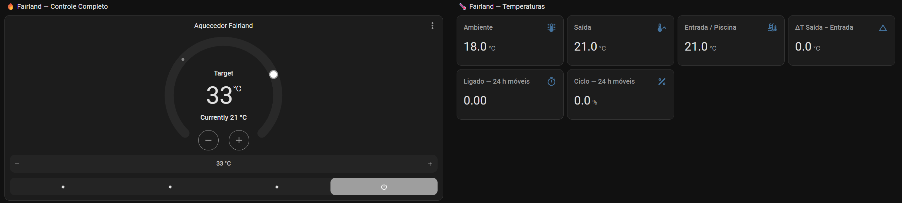

# Painel

A integração **não cria nem altera painéis**. Ela cria entidades padrão do Home Assistant; o painel é opcional. Este guia mostra como usar o exemplo nativo incluído no pacote.

## Captura real do exemplo

*Captura real de tela de um painel de exemplo. Não é diagrama.*

Leitura da captura:

- **Cartão "Aquecedor Fairland" (controle de termostato):** mostra o alvo e a temperatura atual. Os botões da base do cartão não têm rótulos legíveis na captura, então não são descritos aqui. O exemplo usa o cartão `thermostat` com a entidade `water_heater`; confirme o comportamento na sua versão do Home Assistant.
- **Cartão "Entrada / Piscina":** é a temperatura da **água na entrada do equipamento** (sensor de entrada). **Não é uma sonda separada da piscina.** Veja [Operação](operation.md#significado-dos-sensores-de-temperatura).
- **Cartão "Saída":** temperatura da água na saída do equipamento.
- **Cartão "Ambiente":** temperatura do ar reportada.
- **Cartão "ΔT Saída – Entrada":** diferença entre saída e entrada, calculada **no painel**. **Não é uma entidade criada pela integração.** Você pode criá-la com um sensor de modelo, se quiser; o exemplo incluído não a usa.
- **Cartões "Ligado — 24 h móveis" e "Ciclo — 24 h móveis":** são as métricas de 24 horas do fabricante. Não são medição de energia.

Os nomes dos cartões na captura foram escolhidos pelo autor do painel. Os nomes do exemplo incluído podem ser diferentes.

## Arquivo de exemplo

[`examples/dashboard-native.yaml`](../examples/dashboard-native.yaml) usa apenas cartões nativos do Home Assistant: `thermostat`, `entities`, `tile`, `heading` e `history-graph`. Não exige cartões personalizados, Mushroom, card-mod ou outro add-on.

Estrutura:

| Visão | Conteúdo |
|---|---|
| **Piscina** | Controle do aquecedor, modo do ventilador, indicadores de funcionamento, conexão e problema; temperaturas de entrada, saída e ambiente; histórico de 24 horas; estado das agendas (somente leitura) |
| **Diagnóstico** | Estado do equipamento, código de erro bruto, versão e data de atualização da agenda |

## Como aplicar

1. Instale e configure a integração ([Configuração](configuration.md)).
2. Abra **Configurações → Dispositivos e serviços → Tholz Fairland** e anote os IDs das entidades. Você também pode buscá-los em **Ferramentas do desenvolvedor → Estados** pelo prefixo `fairland` ou pelo nome que você escolheu.
3. Abra o painel onde quer usar o exemplo (ou crie um novo) e entre no **modo de edição**.
4. Abra **Editar no modo YAML** (ou o editor bruto de configuração) e cole o conteúdo de `dashboard-native.yaml` como uma nova **visão**. Para painéis em modo automático, use o editor do painel.
5. Substitua os IDs de exemplo pelos seus. Os exemplos usam o nome padrão `Fairland`:

   | No exemplo | Substitua por (exemplo de instalação com outro nome) |
   |---|---|
   | `water_heater.fairland_pool` | `water_heater.<seu_nome>_pool` |
   | `select.fairland_fan_mode` | `select.<seu_nome>_fan_mode` |
   | `sensor.fairland_inlet_temperature` | `sensor.<seu_nome>_inlet_temperature` |

6. Salve e confira se todos os cartões mostram valores. Um cartão em branco ou com "Entidade não encontrada" indica ID errado.

Para verificar IDs de uma vez, use **Ferramentas do desenvolvedor → Modelos** com `{{ states.water_heater | map(attribute='entity_id') | list }}` e equivalentes para `select`, `sensor` e `binary_sensor`.

## Regras de uso do painel

- **Cartão de controle:** os comandos alteram o **equipamento físico**. Confira a entidade antes de usar.
- **Indicador "Heat pump running":** mostra o estado reportado de funcionamento. **Não é um interruptor de energia.**
- **Agendas:** somente leitura. O exemplo as mostra, mas não as altera.
- **Diagnóstico:** separado do controle diário. Não é necessário para operar o aquecedor.
- O exemplo **não sobrescreve** painéis existentes. Ele é um ponto de partida.

## Nomes e sufixos

Os IDs das entidades dependem do nome escolhido no cadastro. Se já existir uma entidade com o mesmo nome, o Home Assistant acrescenta um sufixo numérico, por exemplo `sensor.fairland_inlet_temperature_2`. Sempre confira o ID real antes de copiar o exemplo.

## Próximos passos

- [Automações](automations.md): alertas opcionais que você ativa manualmente.
- [Operação](operation.md): significado de cada entidade e limites.
