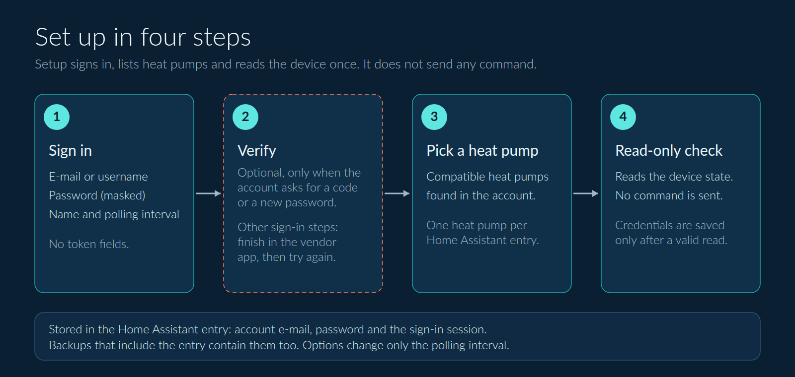
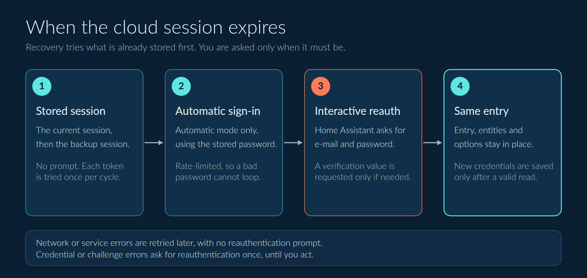

# Configuration

> **Illustrative diagrams** appear below. The screen texts quoted are the integration's own texts in this release; menu names may vary by Home Assistant version.

## Overview

Setup has four stages:

1. **Account:** you enter a name, the e-mail or username, and the manufacturer account password.
2. **Verification (optional):** appears only if the account requires a code or a new password.
3. **Discovery and selection:** the integration lists the compatible devices on the account. If there is more than one, you choose one.
4. **Validation:** before saving, the integration performs a **state read**. It sends no command to the device.

Nothing is saved until the account, discovery and read have all succeeded.

## Step-by-step setup

1. Go to **Settings → Devices & services → Add integration**.
2. Search for **Tholz Fairland**.
3. Fill in the **Connect a Tholz Fairland heat pump** form:

   | Field | What to enter | Notes |
   |---|---|---|
   | Name | A display name, for example `Pool Heat Pump` | Sets the prefix of entity names. Default: `Fairland`. |
   | Account e-mail or username | The e-mail or username you use in the manufacturer app | Use the same login as the app. |
   | Account password | The account password | Masked field. See [Password storage](#password-storage). |
   | Polling interval (seconds) | A value from 10 to 300 | Default 30. See [Polling interval](#polling-interval). |

4. Select **Submit**.
5. If the account asks for verification, follow [Account verification](#account-verification-optional).
6. If several compatible devices exist, choose one in **Select the heat pump**.
7. Wait for validation. The **Tholz Fairland** entry then appears with the name you chose.

## Account verification (optional)

This step appears **only if the account requires it**. Many accounts ask only for the password.

| Screen | When it appears | What to do |
|---|---|---|
| **Complete the sign-in challenge** — field **Verification code or new password** | The account uses a verification code (SMS, e-mail or authenticator app) | Enter the code you received or generated just now. |
| Same screen, masked field | The account requires you to **set a new password** | Enter the new password. It becomes the password stored for automatic recovery. |

Cautions:

- Codes expire quickly. If the message says the value was not accepted, request a new code in the manufacturer app and try again.
- If the account requires a step the integration cannot complete, the screen shows: **"Finish signing in with the vendor app, then try again."** Complete that step in the app and repeat setup.
- Cancelling the screen discards the flow. Nothing is saved.
- Never send a code or new password by chat, e-mail or any other channel. Type it only into the Home Assistant form.

## Device discovery

After sign-in, the integration queries the account and lists only **compatible** devices (Fairland / TurboSilence). Other devices on the account are ignored.

- **One compatible device:** it is added automatically, with no selection screen.
- **Several compatible devices:** the **Select the heat pump** screen lists them. Each device needs its own entry.
- **No compatible device:** the message is **"No compatible Fairland heat pump was found in this account."** Check in the manufacturer app that the device is linked to this account.

After selection, the integration reads the device state once. If that read fails, nothing is saved. The integration **never sends a command during setup**.

## Setup error messages

| Message shown | Meaning | Action |
|---|---|---|
| The account e-mail or password was rejected. | The cloud refused the credentials | Check the e-mail and password in the manufacturer app. |
| Could not authenticate or read the device. No device command was sent. | Network failure, service unavailable or unexpected response | Check Home Assistant's internet access and try again in a few minutes. |
| The verification value was not accepted. | Wrong or expired code or new password | Request a new code and try again. |
| This account needs a sign-in step that cannot be completed here. | Challenge not supported by the integration | Finish the sign-in in the manufacturer app and try again. |
| The cloud configuration is incomplete or inconsistent. | Internal configuration mismatch | Update the integration to the latest available version. |
| The account signed in does not match this device. Nothing was changed. | During reauthentication, the account that signed in is not the entry's original account | Sign in with the same account used during the original setup. |
| This Fairland device is already configured. | The device already has an entry | Use the existing entry. The same device cannot be added twice. |

## Polling interval

- Range: **10 to 300 seconds**. Default: **30 seconds**.
- Controls how often the integration queries the cloud to refresh state.
- Shorter values mean more cloud requests. Longer values make the dashboard lag behind.
- After a command is accepted by the device, the integration may read state before the next interval.

To change it: **Settings → Devices & services → Tholz Fairland → Configure**, adjust the value and save. The entry reloads to apply the new interval. Credentials are **not** changed here.

## Update credentials (Reconfigure)

Use Reconfigure when the account password changes. The account must be the **same** as the entry's: if a different account signs in, the integration refuses the change and nothing is altered.

1. Open **Settings → Devices & services → Tholz Fairland**.
2. Open the entry's menu and choose **Reconfigure**.
3. Enter the e-mail or username and the password.
4. The integration validates the new credentials and a device read. **Only then** does it replace the stored credentials and reload the entry.

Because the entry is reused, the device, entities, dashboards, automations and history are preserved. If validation fails, the old credentials remain stored.

## Reauthentication

When the integration cannot keep the session alive, Home Assistant opens a **reauthentication** (it appears as a configuration alert or as **Reauthenticate Tholz Fairland**).

- The screen asks for the e-mail or username and the password, and may ask for the verification code or a new password.
- Credentials are saved only after a valid device read.
- If the account that signs in is different from the original, the integration refuses the change and reports that the account does not match the device.

## Automatic session recovery

You do **not** need to reauthenticate for each session renewal. The integration tries, in order:

1. **Current refresh token.** Renews the session without a password. In most cases this step is enough.
2. **Recovery token.** If the current one is refused, it tries the stored recovery token.
3. **Login with the stored password.** If both are refused, it performs a full login with the stored e-mail and password. This step runs only when a password is stored; entries without a stored password request reauthentication.
4. **Reauthentication.** If the account requires verification, the password has changed, or a configuration failure occurred, the integration opens a reauthentication request and stops retrying on its own.

Automatic-login limits, defined in the integration code:

- At most **3 password logins per day**, per config entry.
- At least **15 minutes** between two logins.
- Temporary failures (network, service rate limits) cause a retry later, after a 30-second wait. They are not treated as a wrong password.
- These counters live in Home Assistant's memory. They start again after a Home Assistant restart.

## Password storage

The integration stores the e-mail or username, the password, the session tokens and the account and device identifiers **in the config entry**. That storage is what enables automatic recovery without your intervention.

- The password field is masked in the interface, but the value is **not individually encrypted** in Home Assistant storage.
- Backups that include the integration also contain these credentials.
- Treat `.storage` and backups as sensitive. See [Privacy and security](privacy.md).

## Allowed values

| Item | Value in this release |
|---|---|
| Target temperature (type 7) | Automatic: **12–40 °C**; Heat: **18–40 °C**; Cool: **12–30 °C**; Off: **12–40 °C**, without turning on when only the temperature is set |
| Operation modes | Off (`off`), Automatic (`automatic`), Heat (`heat`), Cool (`cold`) |
| Fan modes | Silent, Intelligent |
| Polling interval | 10 to 300 s (default 30 s) |

Valid limits reported by the device can only narrow the mode's range, never widen it. The step uses `stepSp` before `step`; if both are absent, the legacy **1 °C** step applies. Present but malformed fields cause the temperature request to be rejected. The value must respect tenths of a degree and the step grid anchored at the effective minimum, without silent rounding.

The interface and transport follow the same policy, with validation against fresh state before sending. An unknown mode blocks temperature requests; changing only the mode does not send a new target temperature. See [Operation → Temperature limits and step](operation.md#temperature-limits-and-step), including when adapting older automations.

## Add another device

Repeat full setup. Each device has its own entry, with its own device record, entities and interval. Two entries for the same device are not allowed.

## Remove an entry

In **Devices & services → Tholz Fairland**, open the entry and choose **Delete**. See [Installation → Removal](installation.md#8-removal) to also remove the integration folder.

## Next steps

- [Operation](operation.md): entities, commands and sensor meanings.
- [Troubleshooting](troubleshooting.md): when setup or recovery does not work.
