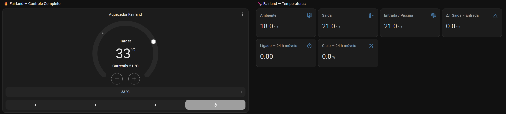

# Dashboard

The integration **does not create or change dashboards**. It creates standard Home Assistant entities; a dashboard is optional. This guide shows how to use the native example included in the package.

## Real capture of the example

*Real screenshot of an example dashboard. It is not a diagram.*

Reading the capture:

- **"Aquecedor Fairland" card (thermostat-style control):** shows the target and the current temperature. The buttons at the bottom of the card have no readable labels in the capture, so they are not described here. The example uses the `thermostat` card with a `water_heater` entity; confirm the behaviour on your Home Assistant version.
- **"Entrada / Piscina" card:** the **inlet water** temperature at the device (inlet sensor). **It is not a separate pool probe.** See [Operation](operation.md#meaning-of-the-temperature-sensors).
- **"Saída" card:** outlet water temperature at the device.
- **"Ambiente" card:** reported air temperature.
- **"ΔT Saída – Entrada" card:** the difference between outlet and inlet, calculated **on the dashboard**. **It is not an entity the integration creates.** You could create it with a template sensor if you want it; the included example does not use it.
- **"Ligado — 24 h móveis" and "Ciclo — 24 h móveis" cards:** the manufacturer's 24-hour metrics. They are not energy measurements.

Card titles in the capture were chosen by the dashboard's author. The included example uses different titles.

## Example file

[`examples/dashboard-native.yaml`](../../examples/dashboard-native.yaml) uses only native Home Assistant cards: `thermostat`, `entities`, `tile`, `heading` and `history-graph`. It needs no custom cards, Mushroom, card-mod or other add-ons.

Structure:

| View | Content |
|---|---|
| **Pool** | Heater control, fan mode, running / online / problem indicators; inlet, outlet and ambient temperatures; 24-hour history; schedule status (read-only) |
| **Diagnostics** | Device status, raw error code, schedule version and last update |

## How to apply it

1. Install and configure the integration ([Configuration](configuration.md)).
2. Open **Settings → Devices & services → Tholz Fairland** and note the entity IDs. You can also search **Developer tools → States** for the prefix `fairland` or the name you chose.
3. Open the dashboard where you want the example (or create a new one) and enter **edit mode**.
4. Open the raw configuration editor (or **Edit in YAML**) and paste the contents of `dashboard-native.yaml` as a new **view**. For auto-generated dashboards, use the dashboard editor.
5. Replace the example IDs with yours. The example uses the default name `Fairland`:

   | In the example | Replace with (example for a different name) |
   |---|---|
   | `water_heater.fairland_pool` | `water_heater.<your_name>_pool` |
   | `select.fairland_fan_mode` | `select.<your_name>_fan_mode` |
   | `sensor.fairland_inlet_temperature` | `sensor.<your_name>_inlet_temperature` |

6. Save and confirm all cards show values. A blank card or "Entity not found" means a wrong ID.

To list IDs at once, use **Developer tools → Template** with `{{ states.water_heater | map(attribute='entity_id') | list }}`, and similar expressions for `select`, `sensor` and `binary_sensor`.

## Usage rules for the dashboard

- **Control card:** commands change the **physical device**. Confirm the entity before using it.
- **"Heat pump running" indicator:** shows the reported running state. **It is not a power switch.**
- **Schedules:** read-only. The example displays them but does not change them.
- **Diagnostics:** separated from daily controls. Not needed to operate the heater.
- The example **never overwrites** an existing dashboard. It is a starting point.

## Names and suffixes

Entity IDs depend on the name chosen during setup. If an entity with the same name already exists, Home Assistant appends a numeric suffix, for example `sensor.fairland_inlet_temperature_2`. Always check the actual ID before copying the example.

## Next steps

- [Automations](automations.md): optional alerts you enable yourself.
- [Operation](operation.md): meaning of each entity and limits.
