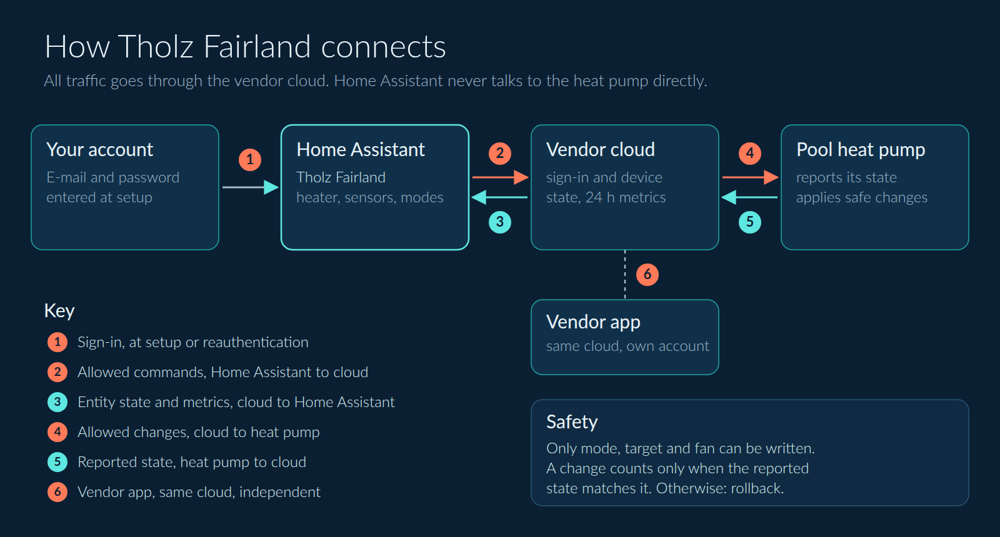
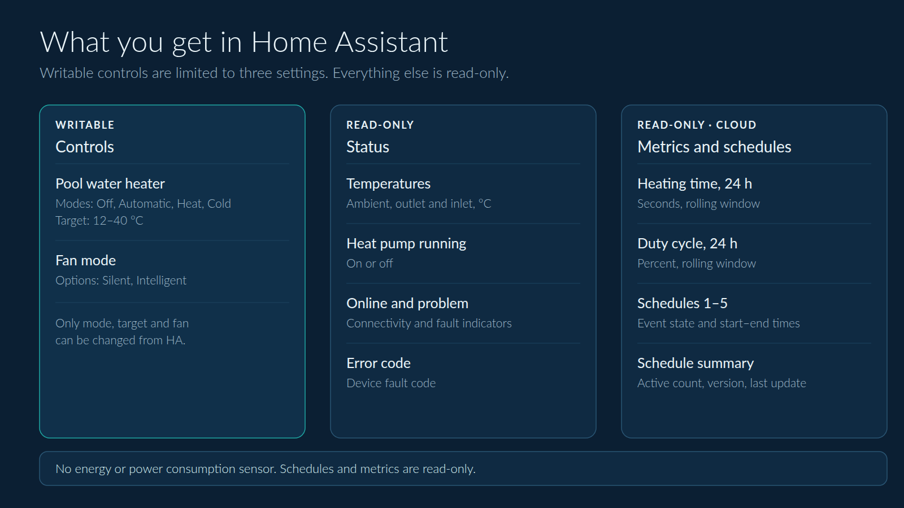
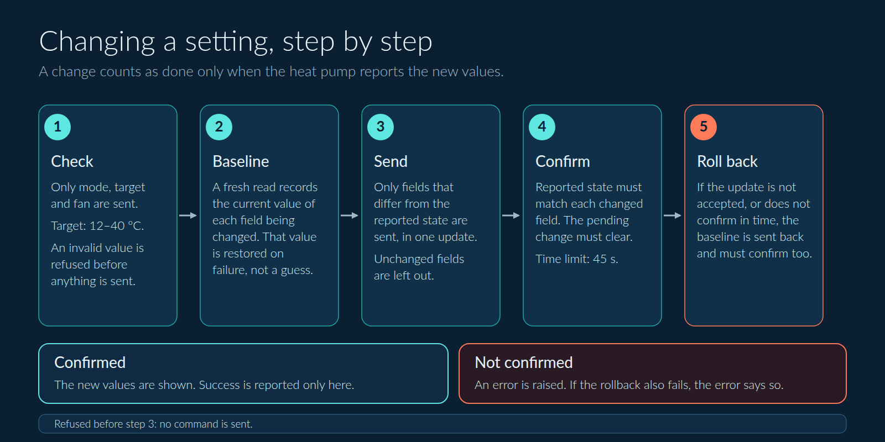

# Operation

> **Illustrative diagrams** of the architecture, entities and command lifecycle appear below. They are not screenshots.

## How the integration works

- The integration is **cloud-only**. Home Assistant talks to the manufacturer's services, which communicate with the device.
- State is refreshed periodically (configurable interval). Entities read the latest value held in memory, so Home Assistant does not query the cloud once per entity.
- Commands follow a controlled cycle, described in [Command lifecycle](#command-lifecycle).

## Entities created

Names below use the prefix you chose during setup (shown here as `<name>`). The names are the ones the integration creates in this release: the heater, fan, temperature and indicator entities use **English**; the 24-hour metrics and schedules use **Portuguese**. Entity IDs derive from these names and receive a numeric suffix if an entity with the same name already exists. Examples in these guides use the default name `Fairland`, for example `water_heater.fairland_pool`.

| Entity (name) | Type | Access | Meaning |
|---|---|---|---|
| `<name> Pool` | Water heater | Read and write | Operation mode, target temperature and current temperature |
| `<name> Fan mode` | Select | Read and write | Fan mode: **Silent** or **Intelligent** |
| `<name> Ambient temperature` | Temperature sensor | Read | Reported ambient temperature |
| `<name> Inlet temperature` | Temperature sensor | Read | Water temperature at the device **inlet** |
| `<name> Outlet temperature` | Temperature sensor | Read | Water temperature at the device **outlet** |
| `<name> Heat pump running` | Binary sensor (running) | Read | Reported indicator that the device is operating |
| `<name> Online` | Binary sensor (connectivity) | Read | Connection reported by the cloud |
| `<name> Problem` | Binary sensor (problem) | Read | On when the error code is not zero |
| `<name> Error code` | Diagnostic sensor | Read | Raw error code reported by the device |
| `<name> Tempo Aquecendo 24h` | Duration sensor (seconds) | Read | Active time calculated by the integration from manufacturer records over a rolling 24-hour window |
| `<name> Ciclo de Aquecimento 24h` | Sensor (%) | Read | Activity percentage calculated by the integration for the same window |
| `<name> Agenda 1` to `Agenda 5` | Sensor | Read | Schedule slot: `Ativa` or `Desativada`, with times |
| `<name> Agendas Ativas` | Sensor (count) | Read | How many schedule slots are active |
| `<name> Agenda Versão` | Diagnostic sensor | Read | Schedule version reported by the device |
| `<name> Agenda Atualizada` | Diagnostic sensor (timestamp) | Read | Last schedule update reported by the device |

Notes:

- Temperature sensors are created only if the device reports the value **when setup or reload runs**. If an entity is missing, see [Missing or unavailable entities](troubleshooting.md#missing-or-unavailable-entities).
- The schedule entities are also created at setup, when the device reports its schedule.
- **Online** and **Problem** exist only when the device reports those fields.
- Availability depends on the fields the device and cloud service report.

## Meaning of the temperature sensors

| Sensor | What it represents |
|---|---|
| Ambient temperature | Air temperature, as reported by the device |
| Inlet temperature | Water **entering** the device |
| Outlet temperature | Water **leaving** the device |

Important:

- The **current temperature** of the water heater entity (`<name> Pool`) is the **inlet** reading, not the outlet or ambient reading.
- In the example dashboard capture, the card labelled **Entrada / Piscina** shows the **inlet water** temperature. **It is not a separate pool probe.** If the pool water differs from the inlet reading, that is expected: the reading reflects the water passing through the device.
- The integration does not calibrate the sensors. Values are whatever the manufacturer reports.
- This candidate has not been checked against a physical probe layout. Confirm readings against the device or the manufacturer's app.

## Meaning of the indicators

| Indicator | On when | Limits |
|---|---|---|
| Heat pump running | The device reports its running flag | Shows the reported state. It is **not a power switch** and does not measure heating power. |
| Online | The cloud reports the device connected | If off, commands may fail. See [Troubleshooting](troubleshooting.md). |
| Problem | The error code is different from 0 | Does not interpret the code. Check the manufacturer's manual or app for meaning. |
| Error code | Always shows the reported number | Raw value, not translated. |

## 24-hour metrics

- **Data source:** the manufacturer's API provides the rows of the `activeTime` table. The integration selects `heat0` records from the cutoff of the **rolling 24-hour** window and adds their non-negative active durations.
- **Local calculation:** `summarize_metrics_document`, in `custom_components/tholz_fairland/cloud/client.py`, converts that sum from milliseconds to seconds and calculates its percentage of the 24-hour window. **Tempo Aquecendo 24h** is rounded to one decimal place; **Ciclo de Aquecimento 24h**, to two. The service does not supply a ready-made percentage for these sensors.
- **Cache:** the summary is held in memory for **5 minutes**, independently of the state polling interval. The next read after that period attempts another metrics query; the entities do not recalculate the window every second.
- **Non-authentication failures:** if the first query fails, the summary is `{}` and the sensors have no value, not zero. If a summary already exists, it is retained and may become stale. The fallback result also observes the 5-minute wait before another query.
- **Authentication/authorization:** HTTP **401/403** responses propagate as an authentication error; they are not hidden as an optional metrics failure.
- Results depend on the records received; they do not guarantee a complete history or equivalence to every app chart. **They do not measure energy, power, kWh, cost or efficiency.**

## Schedules: read-only

- The schedules (`Agenda 1` to `Agenda 5`) are **read-only**. You can view them in Home Assistant but **cannot edit them** there.
- To change a schedule, use the manufacturer's app.
- State: `Ativa · HH:MM-HH:MM` or `Desativada · HH:MM-HH:MM`.
- Attributes per slot: `slot`, `active`, `turn_on`, `turn_off`, `repeat_mask`, `repeat_days`, `repeat_description`, `read_only: true`.
- `repeat_mask` preserves the numeric `rept` value. `repeat_days` lists the selected days **in Portuguese**, ordered **Monday to Sunday**. `repeat_description` presents those days as readable text; these attribute values remain Portuguese in an English Home Assistant interface.
- The mask values are Monday **32**, Tuesday **16**, Wednesday **8**, Thursday **4**, Friday **2**, Saturday **1** and Sunday **64**. Combinations add the values of the selected days.
- `0` produces `repeat_days: []` and `repeat_description: "Nenhum dia"` (no days); `127` lists all seven days with **"Todos os dias"** (every day). Zero is not presented as a one-time execution.
- The displayed days describe the reported repetition, not a prediction of the next execution.
- The integration does not create, change, enable or disable schedules.

## Commands

Three items are writable: **operation mode**, **target temperature** and **fan mode**. No other field is written.

| Command | Accepted values | Note |
|---|---|---|
| Operation mode | Off (`off`), Automatic (`automatic`), Heat (`heat`), Cool (`cold`) | Internal values. The project README calls the last mode "Cool"; see [FAQ](FAQ.md). |
| Target temperature | Automatic: 12–40 °C; Heat: 18–40 °C; Cool: 12–30 °C | Reported limits may narrow the range. See the rules below, including Off mode. |
| Fan mode | Silent, Intelligent | Two values only. |

Use the water heater card on the dashboard, the select entity, or Home Assistant's standard actions. **Each command changes the physical device.** Confirm the entity before using it.

### Temperature limits and step

The entity and transport use the same policy for Fairland **type 7**:

| Mode | Base target-temperature range |
|---|---|
| Automatic (`automatic`) | 12–40 °C |
| Heat (`heat`) | 18–40 °C |
| Cool (`cold`) | 12–30 °C |
| Off (`off`) | 12–40 °C, preserving the legacy range; setting only the temperature does not turn the device on |

- Valid `minSp` and `maxSp` limits can only **narrow** the base range, never widen it. An inconsistent resulting range causes a temperature request to be rejected.
- The step comes from `stepSp`, which takes precedence over `step`; both use tenths of a degree. **Only when both are absent** does the legacy **1 °C** step apply. A present but malformed limit or step field is not treated as absent: the temperature request is rejected.
- A value must be an exact multiple of **0.1 °C** and lie on the step grid anchored at the **effective minimum**. There is no silent rounding or automatic adjustment into range.
- Before sending, the transport validates the request against a **fresh state read**. An automation or direct action cannot bypass the policy; a mode or limit change since the interface read may cause rejection.
- An unknown reported mode blocks temperature commands. Changing **only the mode** does not add `sp` or automatically correct the temperature.
- Restoration values are also validated before the first send. A baseline temperature incompatible with the original mode or step, or a malformed baseline, blocks the command rather than being replayed during rollback.

Automations that previously relied only on the general 12–40 °C range may now receive an error. Check the current mode, range and step before setting a temperature.

### Command lifecycle

1. The integration **reads the current state** of the device, validates the request and keeps the values it is about to change. An invalid temperature is rejected before sending.
2. It sends **only** the field being changed.
3. It waits up to **45 seconds** for the reported state. Success requires the reported state to match the requested value **and** no pending change to remain.
4. If the device does not converge, the integration tries to **restore the previous value**.
5. If the restore also fails, the message reports that returning to the previous state failed. **Check the device physically.**

Practical consequences:

- The value shown in Home Assistant can take several seconds to change.
- If the device does not accept the command, the value returns to the previous one.
- A failed command can leave the device unavailable for a while, even after the restore attempt.

## Limits of this release

- **Cloud only.** Without the cloud there is no reading and no command. There is no local mode.
- **No schedule control.** Schedules are read-only.
- **Only the three commands listed above.** No other mode, time or function is supported.
- **No energy metrics.** Times and percentages are calculated locally from manufacturer records and do not represent consumption.
- **Manufacturer dependency.** Changes to the service, the account or the interfaces can make entities unavailable.

## Next steps

- [Dashboard](dashboard.md): an example card set ready to adapt.
- [Automations](automations.md): optional alerts.
- [Troubleshooting](troubleshooting.md): when something does not match.
