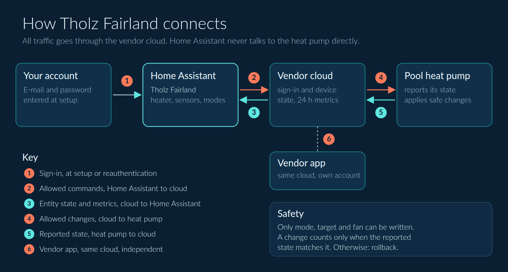
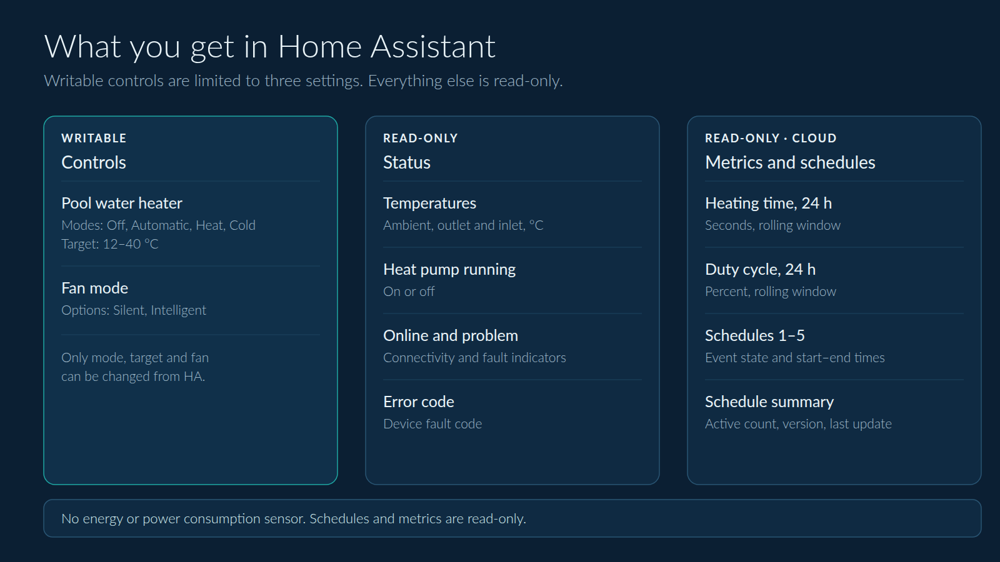
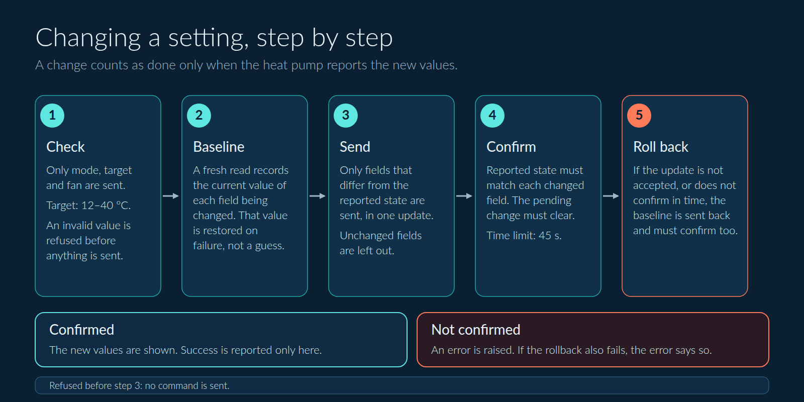

# Operação

> **Diagrama ilustrativo** da arquitetura e dos ciclos abaixo. Não é captura de tela.

## Como a integração funciona

- A integração é **somente nuvem**. O Home Assistant conversa com os serviços do fabricante, que se comunicam com o equipamento.
- O estado é lido periodicamente (intervalo configurável). Cada entidade lê o último valor guardado na memória, então o Home Assistant não faz uma consulta à nuvem por entidade.
- Os comandos seguem um ciclo controlado, descrito em [Ciclo de um comando](#ciclo-de-um-comando).

## Entidades criadas

Os nomes abaixo usam o prefixo que você escolheu no cadastro (aqui, `<nome>`). Os nomes são os que a integração cria nesta versão: as entidades do aquecedor, do ventilador, das temperaturas e dos indicadores usam **inglês**; as métricas de 24 horas e as agendas usam **português**. Os IDs de entidade derivam desses nomes e podem receber um sufixo numérico se já existir uma entidade com o mesmo nome. Os exemplos deste guia usam o nome padrão `Fairland`, por exemplo `water_heater.fairland_pool`.

| Entidade (nome) | Tipo | Acesso | Significado |
|---|---|---|---|
| `<nome> Pool` | Aquecedor (water heater) | Leitura e escrita | Modo de operação, temperatura-alvo e temperatura atual |
| `<nome> Fan mode` | Seletor | Leitura e escrita | Modo do ventilador: **Silent** ou **Intelligent** |
| `<nome> Ambient temperature` | Sensor de temperatura | Leitura | Temperatura ambiente reportada |
| `<nome> Inlet temperature` | Sensor de temperatura | Leitura | Temperatura da água na **entrada** do equipamento |
| `<nome> Outlet temperature` | Sensor de temperatura | Leitura | Temperatura da água na **saída** do equipamento |
| `<nome> Heat pump running` | Sensor binário (executando) | Leitura | Indicador reportado de que o equipamento está em funcionamento |
| `<nome> Online` | Sensor binário (conectividade) | Leitura | Conexão reportada pela nuvem |
| `<nome> Problem` | Sensor binário (problema) | Leitura | Ligado quando o código de erro é diferente de zero |
| `<nome> Error code` | Sensor de diagnóstico | Leitura | Código de erro bruto reportado pelo equipamento |
| `<nome> Tempo Aquecendo 24h` | Sensor de duração (segundos) | Leitura | Tempo ativo nas últimas 24 horas, segundo a nuvem |
| `<nome> Ciclo de Aquecimento 24h` | Sensor (%) | Leitura | Percentual de tempo ativo nas últimas 24 horas |
| `<nome> Agenda 1` a `Agenda 5` | Sensor | Leitura | Estado da agenda: `Ativa` ou `Desativada`, com horário |
| `<nome> Agendas Ativas` | Sensor (contagem) | Leitura | Quantas agendas estão ativas |
| `<nome> Agenda Versão` | Sensor de diagnóstico | Leitura | Versão da agenda reportada pelo equipamento |
| `<nome> Agenda Atualizada` | Sensor de diagnóstico (data/hora) | Leitura | Última atualização da agenda reportada |

Notas:

- Os sensores de temperatura só são criados se o equipamento reportar o valor **no momento do cadastro ou da recarga**. Se faltar uma entidade, veja [Entidades ausentes](troubleshooting.md#entidades-ausentes-ou-indisponíveis).
- As entidades de agenda também são criadas no cadastro, quando o equipamento informa a agenda.
- **Online** e **Problem** só existem se o equipamento reportar esses campos.
- A disponibilidade depende dos campos que o equipamento e a nuvem reportam.

## Significado dos sensores de temperatura

| Sensor | O que representa |
|---|---|
| Temperatura ambiente | Temperatura do ar, segundo o equipamento |
| Temperatura de entrada | Água que **entra** no equipamento |
| Temperatura de saída | Água que **sai** do equipamento |

Importante:

- A **temperatura atual** do aquecedor (`<nome> Pool`) é a leitura de **entrada**, não a de saída nem a ambiente.
- Na captura do painel de exemplo, o cartão **Entrada / Piscina** mostra a temperatura da **água na entrada** do equipamento. **Não é uma sonda separada da piscina.** Se a água da piscina estiver muito diferente da leitura de entrada, isso é esperado: a leitura reflete o que passa pelo equipamento.
- A integração não calibra os sensores. Os valores são os que o fabricante reporta.
- Esta candidata não foi conferida contra a posição física das sondas. Confirme as leituras no equipamento ou no aplicativo do fabricante.

## Significado dos indicadores

| Indicador | Ligado quando | Limites |
|---|---|---|
| Heat pump running | O equipamento reporta a flag de funcionamento | Mostra o estado reportado. **Não é um interruptor de energia** e não mede a potência de aquecimento. |
| Online | A nuvem reporta o equipamento conectado | Se desligado, os comandos podem falhar. Veja [Solução de problemas](troubleshooting.md). |
| Problem | O código de erro é diferente de 0 | Não interpreta o código. Consulte o manual ou o aplicativo do fabricante para o significado. |
| Error code | Sempre mostra o número reportado | Valor bruto, sem tradução. |

## Métricas das últimas 24 horas

- **Tempo Aquecendo 24h** (segundos) e **Ciclo de Aquecimento 24h** (%) vêm do serviço de métricas do fabricante.
- O percentual é o valor calculado pelo serviço do fabricante; a integração não calcula essa métrica. As métricas são consultadas no máximo a cada **5 minutos**.
- São **medidas reportadas pelo fabricante**, não medição de energia. A integração **não informa consumo de energia, kWh nem custo**.
- Se o serviço de métricas falhar, os sensores podem mostrar valor vazio até a próxima consulta bem-sucedida.

## Agendas: somente leitura

- As agendas (`Agenda 1` a `Agenda 5`) são **somente leitura**. Você as visualiza no Home Assistant, mas **não as edita** por ele.
- Para alterar uma agenda, use o aplicativo do fabricante.
- Estado: `Ativa · HH:MM-HH:MM` ou `Desativada · HH:MM-HH:MM`.
- Atributos de cada agenda: `slot`, `active`, `turn_on`, `turn_off`, `repeat_mask`, `repeat_description` e `read_only: true`.
- Máscara de repetição: `127` significa **todos os dias**; `0` significa **nenhum dia**. Outros valores aparecem como "Máscara semanal N (dias ainda não mapeados)" no atributo `repeat_description`; confira esses dias no aplicativo do fabricante.
- A integração não cria, altera nem liga/desliga agendas.

## Comandos

Você pode alterar três itens: **modo de operação**, **temperatura-alvo** e **modo do ventilador**. Nenhum outro campo é gravado.

| Comando | Valores aceitos | Observação |
|---|---|---|
| Modo de operação | Desligado (`off`), Automático (`automatic`), Aquecer (`heat`), Resfriar (`cold`) | Estes são os valores internos da integração. O README do projeto chama o último modo de "Cool"; veja [FAQ](FAQ.md). |
| Temperatura-alvo | 12 a 40 °C | Valores fora da faixa são recusados antes do envio. |
| Modo do ventilador | Silent, Intelligent | Dois valores somente. |

Para alterar, use o cartão do aquecedor no painel, a ação do seletor ou a ferramenta padrão do Home Assistant. **Cada comando altera o equipamento físico.** Confirme a entidade antes de usar.

### Ciclo de um comando

1. A integração **lê o estado atual** do equipamento e guarda os valores que serão alterados.
2. Envia **somente** o campo alterado.
3. Aguarda até **45 segundos** pelo estado reportado. Sucesso exige que o estado reportado coincida com o valor pedido **e** que não haja mudança pendente.
4. Se o equipamento não convergir, a integração tenta **restaurar o valor anterior**.
5. Se a restauração também falhar, a mensagem indica falha no retorno ao estado anterior. **Verifique o equipamento fisicamente.**

Consequências práticas:

- O valor mostrado no Home Assistant pode demorar alguns segundos para mudar.
- Se o equipamento não aceitar o comando, o valor volta ao anterior.
- Um comando com falha pode deixar o equipamento indisponível por algum tempo, mesmo após a tentativa de restauração.

## Limites desta versão

- **Somente nuvem.** Sem nuvem, não há leitura nem comando. Não há modo local.
- **Sem controle de agendas.** As agendas são somente leitura.
- **Somente os três comandos listados.** Nenhum outro modo, horário ou função é suportado.
- **Sem métricas de energia.** Os tempos e percentuais vêm do fabricante e não representam consumo.
- **Dependência do fabricante.** Mudanças no serviço, na conta ou nas interfaces podem deixar entidades indisponíveis.

## Próximos passos

- [Painel](dashboard.md): exemplo de cartão pronto para adaptar.
- [Automações](automations.md): alertas opcionais.
- [Solução de problemas](troubleshooting.md): quando algo não bate.
